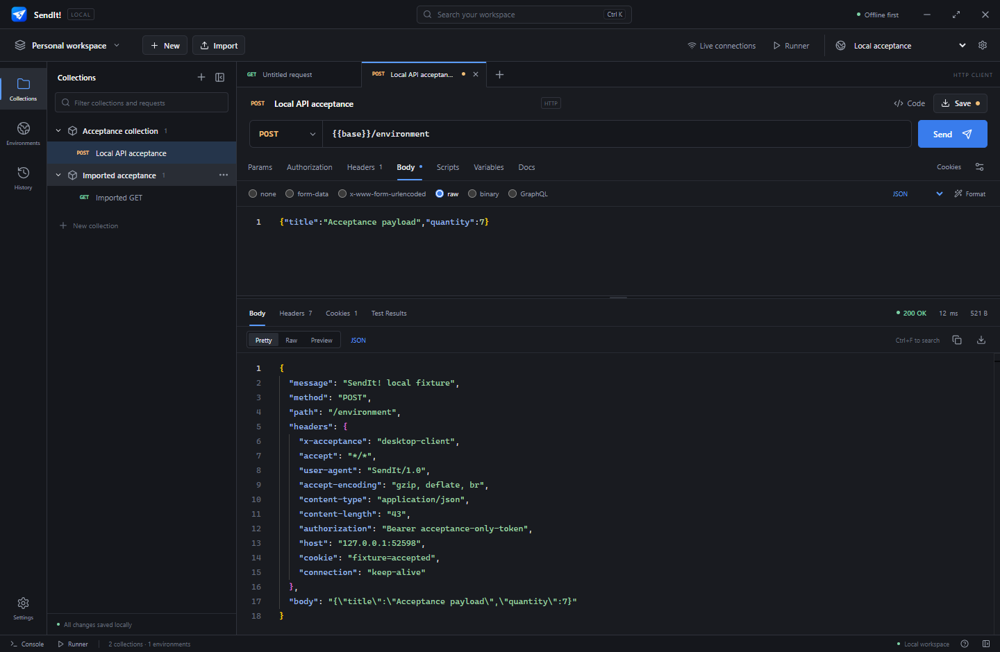
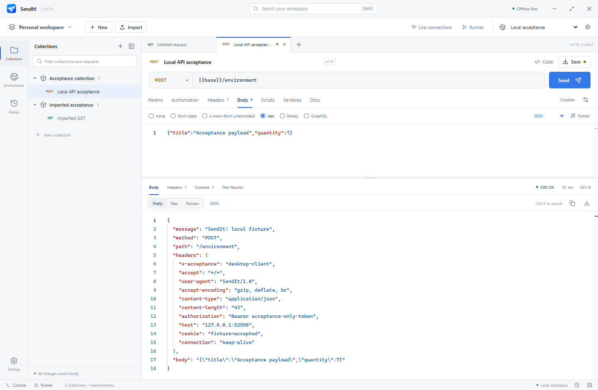
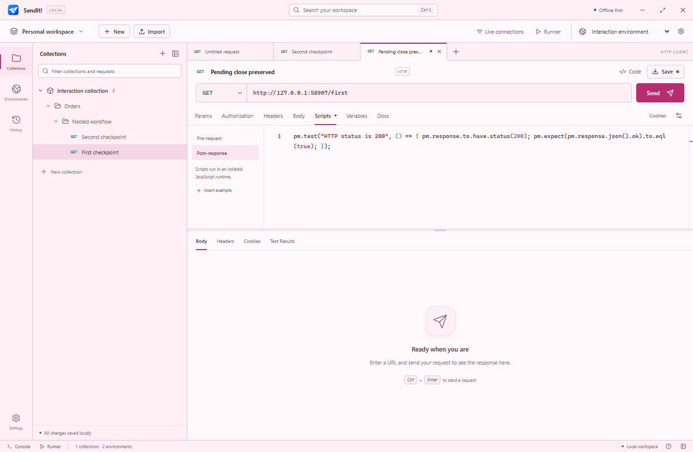
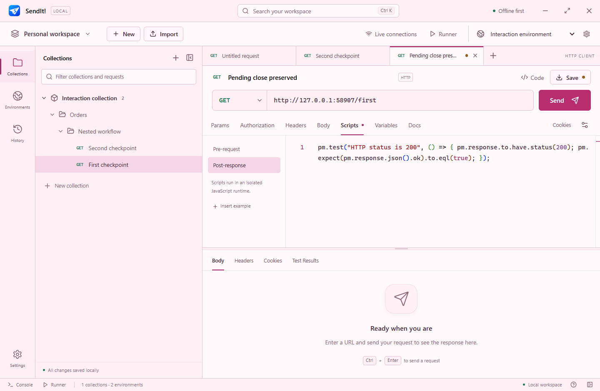
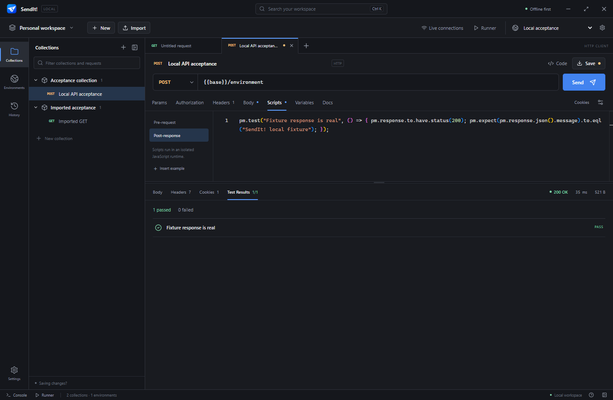
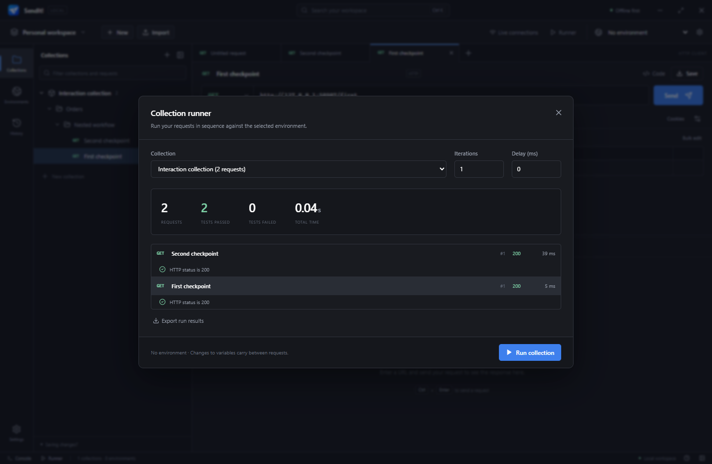
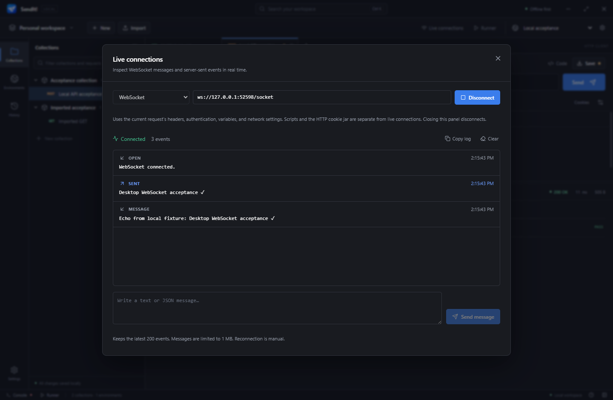
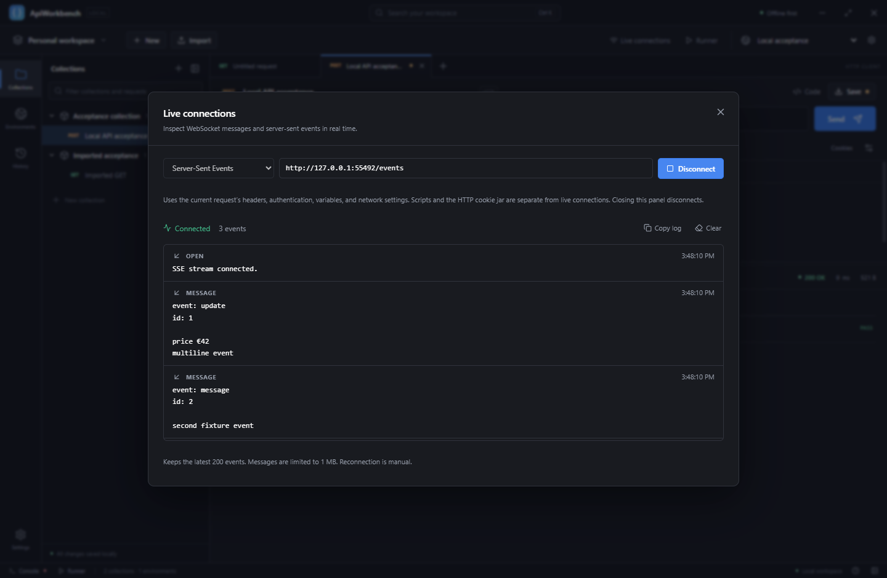

# SendIt!


A local Windows desktop workspace for building, sending, organizing and testing API requests. No account, telemetry or application server is required. This is an independent application with original branding, informed by documented API-client workflows; it is not affiliated with Postman.



## Portable Windows release

Run **`dist/SendIt-Portable-Win-x64.exe`** on Windows 10/11 x64. No installation wizard, administrator privileges, Node.js, npm or Python are required. The launcher temporarily extracts its bundled Electron runtime. Keep the executable in a writable directory; persistent data lives in **`SendIt-data` beside the EXE**. First launch may take longer while the runtime is extracted.

The executable is unsigned. The delivered release is **104,912,457 bytes**, verified by direct launch and restart on Windows 11 Pro x64 (10.0.26200). Windows 10 is targeted but not individually tested. SHA-256: `ce0bf3bdf9e3ce83a8bd37fab64b15fc75e9d183b8dfeb115adfb9a952b098c3`. Detailed evidence is in [TEST_REPORT.md](docs/TEST_REPORT.md) and `dist/RELEASE.json`.

The complete source archive is `dist/SendIt-Source.zip`. Extract it, then run the build commands below to recreate a release. The source archive intentionally excludes dependencies, generated program files, test workspace data and proprietary research imagery.

## Features

- Native HTTP/HTTPS with standard/custom methods, query synchronization, editable enabled header/parameter rows and bulk editing.
- JSON, XML, HTML, JavaScript/plain text, URL-encoded forms, multipart files, binary uploads and GraphQL over HTTP.
- Cancellation, timeouts, redirects, verified TLS by default, HTTP/HTTPS proxies, gzip/deflate/Brotli, persistent cookies, bounded large/binary responses.
- Basic, Bearer, API Key, Digest, OAuth client credentials and refresh-token authentication, plus collection/folder inheritance.
- Local workspaces, collections, nested folders, descriptions, request duplication/movement, drag organization, search and history.
- Multiple draft tabs, restart restoration, unsaved indicators, resizable panes, custom window title, dark/light/pink themes, app zoom, context menus and keyboard shortcuts.
- Environment, global, collection and request variables; recursive double-brace substitution and explicit missing/cyclic-variable errors.
- Isolated pre-request/post-response scripts, named test results, common assertions, variable mutation and a redacted console.
- Collection runner with iterations, delay, cancellation, variable chaining and exported summaries.
- Editable Postman v2.1 collection/environment import/export, safe cURL import, cURL/HTTP snippets and offline Markdown documentation.
- Separate WebSocket and SSE live tools with headers, authentication, variable resolution, TLS/proxy settings and bounded event logs.
- Native response/file saving, explicit JSON backup/restore and Windows-protected recognized credentials.



## Screenshots

| Pink theme                                              | Larger interface at 125%                                     |
| ------------------------------------------------------- | ------------------------------------------------------------ |
|  |  |

| Request tests                                                     | Collection runner                                                    |
| ----------------------------------------------------------------- | -------------------------------------------------------------------- |
|  |  |

| WebSocket connections                                                | Server-sent events                                             |
| -------------------------------------------------------------------- | -------------------------------------------------------------- |
|  |  |

## Development and reproducible build

Use Windows x64, Node.js 24.16 or newer and npm. All dependency versions are pinned by `package-lock.json`.

```powershell
npm ci
node node_modules/electron/install.js
npm run check
npm test
npm run build
npm run test:e2e
node tests/ui-interactions.mjs
npm run package
node tests/release-smoke.mjs
```

`npm run dev` builds and opens the local desktop application. `npm run build` type-checks and bundles main/preload/renderer. `npm run package` generates the single portable Windows EXE using electron-builder. Some npm versions gate dependency install scripts; the explicit Electron install command above downloads the runtime. The included icon is original and already generated; `powershell -NoProfile -File scripts/icon.ps1` recreates its PNG/ICO assets.

`powershell -NoProfile -File scripts/source-archive.ps1` creates the source ZIP from an explicit file allowlist. Development/build needs network access to package registries and release downloads; normal operation does not need a development server. Build metadata can change the executable hash on subsequent builds.

The development data directory is `<project>/SendIt-data`. Existing data folders from earlier versions are reused when no SendIt-data folder exists; saved requests, credentials and custom titles are preserved. Earlier backups and secret variable exports can still be imported. Tests use isolated directories under `.test-data`. For diagnostics/automation, `SENDIT_DATA_DIR` explicitly overrides the storage root. Ordinary portable usage does not need it. A read-only executable directory produces a relocation instruction instead of silently falling back to a profile directory.

## Everyday workflows

Open **Settings → General** to choose **Dark**, **Light** or **Pink**, and set **App zoom** from **75% to 200%**. Zoom enlarges text, buttons, panels and code editors together. Use **Ctrl + +** (or **Ctrl + =**) to zoom in, **Ctrl + −** to zoom out, and **Ctrl + 0** to return to 100%, including while editing code. Appearance settings save automatically and are restored at startup. Older workspaces default to 100% zoom.

1. Double-click **SendIt-Portable-Win-x64.exe** in the `dist` folder. Click **New** or press **Ctrl+T**. Click **GET** or its arrow to select GET, POST, PUT, PATCH, DELETE, HEAD or OPTIONS; you can also type a custom method. Enter the URL and click **Send** (Ctrl+Enter).
2. Edit Params, Authorization, Headers, Body, Scripts, Variables or Docs. The response pane provides body, headers, cookies and tests. Monaco supports Ctrl+F search and folding.
3. Click **Save** (Ctrl+S), name a collection or choose an existing folder. Collection/folder context menus expose settings, organization and exports.
4. Open **Environments**, create variables, then select the environment above the workbench. Use `{{baseUrl}}/users`, for example.
5. Open **Import** to choose a collection/environment file or paste JSON/cURL. All imported requests remain editable. Imported file references require selecting the local upload file again.
6. Use **Runner** for sequential collection tests or **Live connections** for WebSocket/SSE sessions. Live connections use the current HTTP request's authentication/headers/variables and have a separate lifecycle.

Example post-response script:

```javascript
pm.test('Successful response', () => {
  pm.response.to.have.status(200);
  pm.expect(pm.response.json()).to.be.an('object');
});
```

The complete supported scripting surface is in [SCRIPT_API.md](docs/SCRIPT_API.md). Compatibility details and intentional warnings are in [IMPORT_COMPATIBILITY.md](docs/IMPORT_COMPATIBILITY.md).

## Data and credentials

SQLite commits workspaces, saved requests, drafts, settings and bounded history transactionally. Chromium's profile also stays inside the adjacent data directory. Responses are transient unless explicitly saved.

Recognized auth secrets, marked secret variable values and sensitive headers use Windows DPAPI encryption. **They require the original Windows user account.** For another machine/account, use **Settings → Data → Export backup**, then restore into a fresh destination data directory. Backups and collection/environment JSON exports contain plaintext credentials; the save dialogs label this. Unmarked variables, descriptions, URLs and raw bodies are not encrypted. See [SECURITY.md](docs/SECURITY.md).

## Scope and limits

This release implements the documented local feature set, not complete Postman parity. It excludes Postman cloud sync, collaboration, API networks, AI services and hosted monitors/mocks. Local file exchange, workspaces, descriptions and the runner are the alternatives.

- HTTP/1.1 only; no HTTP/2, gRPC, MQTT, Socket.IO, MCP, client certificates or AWS signing.
- OAuth supports client credentials and refresh-token grants with HTTP Basic client authentication. Authorization code/PKCE, implicit and automatic token refresh are not implemented.
- Scripts are synchronous, bounded QuickJS programs with a documented subset of `pm`/assertions. No async timers, `pm.sendRequest`, external packages, complete Chai compatibility, iteration datasets or workflow branching.
- Uploads and decoded responses are buffered and limited to 50 MB. The renderer shows a labeled 2 MB text preview; saving retains the full response. Workspace/import limits are documented in the implementation report.
- Live streams do not auto-reconnect, follow redirects, execute scripts or share the HTTP cookie jar. WebSocket sending is text; binary messages have a labeled Base64 preview. SSE requests identity encoding.
- Response examples, custom visualization templates, JSONPath/XPath filters, cloud scheduling and cross-machine automatic synchronization are not implemented.
- Source and release validation are recorded in [TEST_REPORT.md](docs/TEST_REPORT.md); passing tests do not establish complete compatibility with every API/provider or every Windows installation.

## Technology and project map

Electron 44, React 19, TypeScript, Vite, Zustand, bundled Monaco, built-in SQLite, native Node networking, QuickJS WASM, tough-cookie, ws, Zod, Vitest and Playwright. Hand-authored CSS tokens provide the dense workbench styling without a general-purpose component framework.

`src/main` owns lifecycle/IPC, `src/preload` the bridge, `src/renderer` the workbench, `src/networking` transports, `src/services` variables/scripts/interchange, `src/storage` SQLite, and `src/shared` contracts/validation.

- [Research and official references](docs/POSTMAN_RESEARCH.md)
- [Feature acceptance matrix](docs/FEATURE_MATRIX.md)
- [Architecture](docs/ARCHITECTURE.md)
- [Logo and branding](docs/BRANDING.md)
- [Implementation status and omissions](docs/IMPLEMENTATION_STATUS.md)
- [Test report and executable verification](docs/TEST_REPORT.md)

MIT-licensed source. Dependency licenses remain their respective owners' licenses. No Postman images or logos are bundled in the application or source archive.
